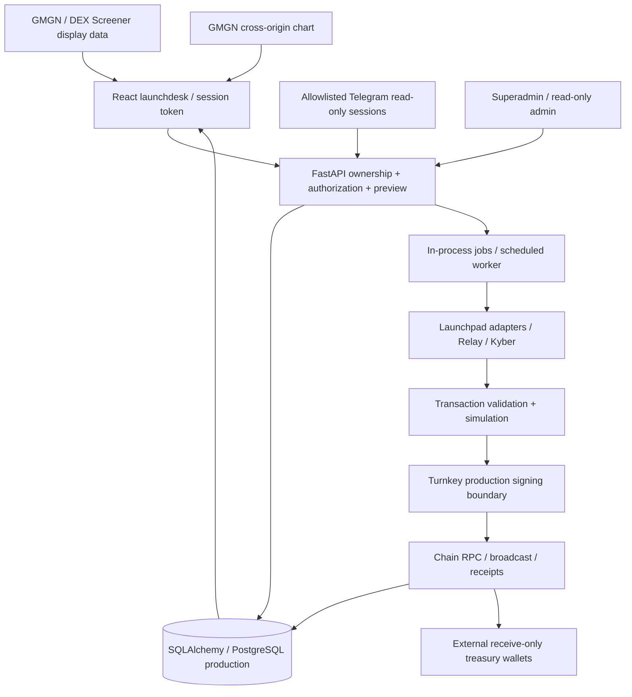
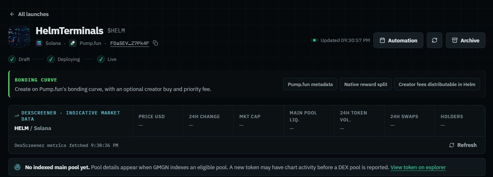
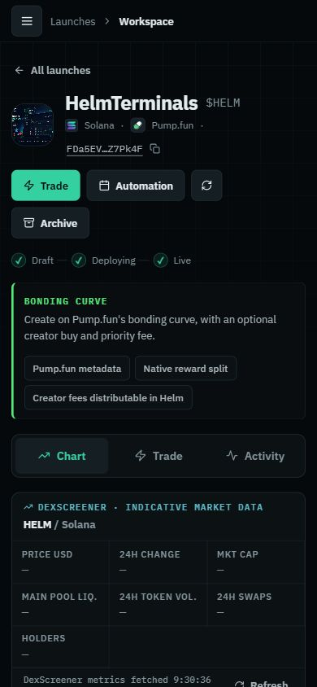

# Helm Terminals — professional engineering audit

**Audited revision:** `main`, `2b8928d`  
**Inspection:** 3–4 October 2026; report completed 4 October 2026 (Africa/Lagos).  
**Scope:** application security, protection of funds, functional correctness, revenue, UI/accessibility, performance and operations.  
**Mode:** audit only. No application edits, commits, pushes, deployments, production setting changes or financial transactions were performed.

## Amendment — independent second pass (4 October 2026, later the same day)

A second independent pass re-verified this report against the repository and the live deployment. One discovery changes the operational picture; the findings themselves stand as written.

### The working tree now contains a large, uncommitted remediation of this report

`git status` shows ~55 modified and ~40 new files implementing these corrections: `backend/app/services/execution_intent.py` (AUD-01 — an immutable `ExecutionIntent` carrying recipients, allowed programs, maximum debits, minimum outputs, fee limits, approval bounds, expiry and authority changes, checked against decoded effects, unknown operations failing closed), `services/quote_approval.py` plus a `quote_approval` confirmation field (AUD-03), `services/execution_journal.py` / `execution_lease.py` / `execution_nonce.py` (AUD-02/11/12), `services/receipt_evidence.py` (AUD-05), `services/pons_reward_view.py` + `frontend/src/components/PonsRewards.tsx` (AUD-08), `routes/recovery.py` + `services/account_recovery.py` + `Recovery.tsx` / `AccountSecurity.tsx` + three migrations (AUD-09), `services/passwords.py` (AUD-12, off-loop Argon2), `frontend/server.mjs` / `security-headers.mjs` (AUD-15/16), a corrected CI workflow (AUD-04) and `docs/helm-remediation-tracker.md`, which honestly keeps every finding **Open**.

Second-pass checks performed: 50 tests across the new suites pass (11 in `test_remediation.py`; 39 across intent/recovery/password-work/kyber-intent/market-pairs/pons-reward-view/postgres-execution, 2 skipped pending live PostgreSQL). `chains/registry.py` is unmodified — **Pons is still listed "available" on the catalog while the splitter is disabled, so the gating gap stands in the remediation tree too.**

### Consequences for this report

- **Deployment equivalence (§2.3) — resolved.** Bundle evidence proves the deployed frontend at `helmterminals.xyz` matches commit `2b8928d` exactly: the served lazy chunks (`Wallets-CfGLZ25e.js`, `Workspace-DO_2EQZs.js`, main index) contain every feature marker of that commit and none of any later work; the deployed `/launchpads` response matches the committed registry. Production runs the audited commit **without** the remediation — every High finding remains live in production until the remediation is committed, end-to-end verified and deployed.
- **AUD-09 — corrected.** "Missing recovery flows" is true of the deployed commit, but the uncommitted tree implements email verification, single-use password-reset tokens, MFA recovery codes and a post-recovery spending hold, with tests. Status: implemented locally, uncommitted, unverified in a rendered flow. The deployed sign-in screen still shows no recovery entry, so the user-facing gap is real in production today.
- **AUD-06 — partially corrected.** Provider-aware market attribution (source-labeled kicker, "Selected by {provider}", activity panel source) landed in commit `400ac71`, an ancestor of the audited commit — the stale GMGN-copy sub-claim does not apply at `2b8928d`. The pair-scope labeling, explicit chainId validation and FDV display points stand.
- **AUD-04 — independently confirmed.** The committed workflow installs `requirements.lock` from the checkout root, where only `backend/requirements.lock` exists, and the contracts job runs `build` before `check`, making the drift check self-comparing. Both defects are fixed in the uncommitted tree.
- **AUD-01/02/03 — independently confirmed at the deployed commit** by source read (the bridge quote is explicitly excluded from the confirmation hash at `routes/bridge.py:91`; execution re-quotes at `services/routing.py` without carrying the reviewed minimum). The remediation addresses them with targeted tests; production verification is still required before any finding may be closed.

### Additional second-pass evidence

- Live production response headers: HSTS, `X-Content-Type-Options: nosniff`, `X-Frame-Options: DENY`, `Referrer-Policy`, and a CSP that is **report-only** — consistent with AUD-15's hardening finding.
- `npm audit --omit=dev` in `frontend/` and `contracts/`: **0 vulnerabilities** in production dependency scope. AUD-10's broader full-scan result (dev dependencies included) stands alongside this.
- Frontend injection-surface scan (`dangerouslySetInnerHTML`, `innerHTML`, `eval(`): no hits in application code — corroborates §3.
- Mobile rendering re-verified live at 390 px after reload; an initial blank frame was traced to stale viewport state in the inspection tooling, not the product.
- Full backend suite at `2b8928d`: **423 passed** in this environment (the earlier interrupted runs in §9 can be treated as superseded by this completed run, within the same limitations).

**Net position after the second pass:** the deployed platform still carries every High finding; a credible remediation exists locally but is uncommitted, undeployed and not end-to-end verified; the Pons catalog gate (this report's §6, REV gate) remains open in both the deployed commit and the remediation tree. Priority order is unchanged: commit and production-verify the remediation, gate the Pons catalog entry, then proceed through §11's gates.

## 1. Executive assessment

Helm is a substantial working launchdesk, with real chain adapters, managed and connected wallet paths, transaction previews, administrative controls, and meaningful tests. It is considerably more than a visual prototype. Its frontend already has a coherent identity, responsive layouts, real chain/launchpad marks, useful unavailable states and a separate market-data surface.

**The reviewed evidence does not justify describing it as mature financial infrastructure ready for unrestricted growth in users and funds.** Four high-priority weaknesses concern the boundary between a user's consent and the transaction signed, recovery after interrupted financial operations, and release verification:

1. Provider-built transactions can pass the guard without proving their recipient, instructions and total spend match the approved action.
2. An interrupted sell can be marked **confirmed when only its approval completed**. This was reproduced against an isolated in-memory database.
3. The displayed bridge quote/minimum is excluded from the confirmation hash; execution obtains another quote without preserving the original minimum.
4. Two CI installation steps reference a nonexistent root lockfile, while the contract check rebuilds artifacts before comparing them, defeating its stated drift-detection purpose.

Revenue reporting also needs work: a successful Kyber swap is treated as proof of a received fee without independently verifying the payment; several creator-reward integrations record configuration or unknown claimable amounts rather than confirmed treasury income. The Pons splitter is thoughtfully bounded but must remain behind its activation gates until independently reviewed and operationally verified.

No Critical vulnerability was established. That is **not** a claim that none exists. This was a source review, isolated testing and read-only browser inspection, not an independent smart-contract audit, exhaustive penetration test, infrastructure assessment or verification of every production integration.

### Strengths to preserve

- Explicit user ownership checks and shared authorization/spend helpers; previews and user-scoped idempotency records precede job execution.
- Production rejects the development signer. Passwords use Argon2; session tokens are hashed in storage; accepted TOTP steps cannot be reused. Transfers out require MFA. Admin access requires a web session and MFA; sensitive writes require fresh credentials.
- Superadmin binding uses a configured immutable user ID plus the designated email on initial binding. Merely registering the owner's email does not grant administration.
- Deterministic transaction identifiers are persisted before broadcast on the reviewed core paths. Uncertain outcomes are generally retained instead of blindly retried.
- Provider outages are not generally converted into zero balances. Portfolio scope, stablecoin valuation assumptions and missing-chain reads have explicit representation.
- Native Pons splitters use immutable beneficiaries, cumulative rounding, independently callable payouts and receipt-based treasury accounting.
- Metadata fetching has public-address restrictions, size/time limits, DNS-aware controls and disabled redirects. These controls should remain covered as adapters evolve.
- Market data is isolated from execution and uses an official hosted chart rather than fabricated historical candles.

## 2. Scope, methods and limits

The working tree was clean at the beginning. HEAD remained `2b8928d` when work resumed on 4 October. The audit adds only this report and two privacy-safe screenshots under `docs/audit-evidence/2026-10-03/`. Previous reports under `docs/audits/` and operational runbooks were treated as claims, not proof of completion. No applicable `AGENTS.md` was found in the inspected repository instruction search.

Evidence included repository architecture/configuration/deployment files; the frontend page/component tree; 127 route decorators in 15 nonempty backend route modules; shared authorization, signing, execution, job and financial services; launchpad adapters; contract source/artifacts; migration and test definitions; existing operational runbooks; the live website; and current official provider documentation. This route count is an inventory, not a claim of 127 independently penetration-tested endpoints.

Live inspection covered authenticated Dashboard, Launches, the Pump.fun creation form without submitting it, a live workspace, Wallets and the Admin revenue view, plus unauthenticated sign-in/registration in a separate tab. Desktop workspace layout was inspected at 1440 pixels and mobile at 390 pixels. Temporary viewport overrides were reset. No account creation, spending, fee changes or admin writes were submitted. The app may perform its normal access logging and read-triggered reconciliation during navigation.

**Deployment equivalence is unverified.** The rendered UI largely matches the source, but no trustworthy deployed commit/build identifier was established. Findings about source are tied to the audited commit; browser observations are separately identified. Live balance values, account details, wallet identifiers and credentials are deliberately omitted.

Important limits:

- No production DB, Railway environment secrets, Turnkey organization policies, backups, edge rules or monitoring configuration were inspected.
- No live deployment, trade, claim, bridge, recovery transaction or rejection of a malicious provider transaction was executed.
- No mainnet fork replay of each launchpad; fresh bytecode retrieval from all deployed contracts was not completed. Pons/Flap address and interface comparisons use current official documentation plus local pins and tests, not an independently attested live deployment.
- No exhaustive browser E2E, axe scan, screen-reader session, Lighthouse run, load test, mobile-device lab or full browser compatibility matrix.
- An earlier full-backend run and an earlier focused run lost their tool process handles across the interruption. No final result was recoverable; they are **inconclusive**, not passes. Completed reruns are listed in section 9.
- No Git-history secret scan or comprehensive third-party infrastructure penetration test. Dependency scans identify known advisories, not application exploitability or unknown vulnerabilities.

Severity: **Critical** means a demonstrated severe, readily exploitable systemic failure; **High** means a material fund/consent/release-integrity defect; **Medium** means meaningful correctness, availability or control weakness; **Low** means limited-impact misleading behavior; **Improvement** means hardening or quality work without a demonstrated exploit. Confidence is distinct from severity. Effort estimates are engineering time, not delivery commitments.

The report records **16 findings: 4 High, 9 Medium, 2 Low and 1 Improvement**. Findings include confirmed defects, conditional design weaknesses and explicitly labelled assurance gaps; they are not sixteen demonstrated exploits.

## 3. Architecture and trust boundaries

Key boundaries:

| Boundary | Existing controls | Remaining concern |
|---|---|---|
| Browser → API | Bearer authentication, ownership, validation, preview hashes, idempotency, selective MFA | XSS could use a session; a hash of a summary is not verification of the final signed transaction |
| Provider → signer | Signer-slot checks, selected ERC-20 checks, simulation, chain-aware senders | AUD-01 and AUD-03: executable intent/minimum output not fully bound |
| API → Turnkey | Server-held signing credentials, no production local signer, references rather than exported private keys | Actual organizational policies, spend constraints, compromise containment and recovery were not independently verified |
| Worker → database/chain | Job/transaction rows, persisted hashes, per-process nonce locks, some rechecks | AUD-02 and AUD-11: incomplete operations can be misclassified; no durable general execution queue or fenced lease |
| Revenue → admin totals | Separate states, asset/network grouping, referral liabilities excluded | AUD-05: quote-derived income can look received; manual review is not receipt verification |
| Third-party markets → UI | Chain/token address routing, cache/backoff, missing values preserved | AUD-06: pair statistics mislabeled token-wide; provider-specific copy is inconsistent |

### Feature ownership and operation traces

| Area | Main code | Trace and assessment |
|---|---|---|
| Identity/session/MFA | `routes/auth.py`, `deps.py`, `security.py`, `services/guard.py` | Form → password/MFA → hashed-token session → revocation. Recovery/email verification are missing (AUD-09). |
| Wallets/folders/main wallets | `routes/wallets.py`, `external_wallets.py`, `ton.py`, `services/main_wallet.py`, `extra_chains.py` | Owner lookup → signer reference or external proof → chain-specific operations. Watch-only cannot sign. Managed TON is intentionally not a generic server-signing path. |
| Launch create/deploy | `routes/launches.py`, `chains/registry.py`, `services/extra_launch.py` | Draft/schema → owned dev wallet → preflight/optional funding → adapter → sign/simulate/send → receipt/token resolution → workspace. Each stage has provider-specific failure modes. |
| Trading/burn/send | `routes/launches.py`, `services/executor.py`, `evm_exec.py` | Owned attached wallets → preview → job → adapter transaction → sender → receipt. Execution guards and incomplete recovery need strengthening. |
| Distribution/consolidation/sweep | `routes/distribute.py`, `services/allocations.py` | Explicit selected wallets/amounts → preview → per-leg transaction records. Partial success must remain distinguishable from completion. Allocation schedules are not proof of on-chain vesting. |
| Bridge/automatic funding | `routes/bridge.py`, `services/routing.py`, `auto_fund.py` | Owned source/destination → quote → approved send amount → fresh provider steps → origin confirmation → destination status. AUD-01/02/03 apply. |
| Scheduled plans | `routes/automations.py`, `services/automation_runner.py` | Finite one-way plans, persisted tranches, budgets and interval limits; restart stops uncertain execution. This feature still exists in the launchdesk. It is not evidence of a volume loop. |
| Market/chart | `routes/market.py`, `services/market.py`, `Market.tsx`, `GmgnChart.tsx` | Token address/chain → cached provider response → indicative metrics; independent hosted chart. No execution authority. |
| Administration | `routes/admin.py`, `services/admin.py`, `platform_config.py` | Bound admin identity → MFA/role → read reports; superadmin credential step-up → audited fee/treasury/access changes. Treasury withdrawals occur outside Helm. |
| Other pages | Profile/public profile, Tracker, Activity, Networks, Settings | Present in routes/components; reviewed structurally and through shared controls. Not every form was interactively exercised. |

The backend is a modular monolith, not a distributed trading engine. Its one-process design is explicit. Scaling replicas without redesigned job ownership and nonce coordination is unsafe even though ordinary requests are asynchronous.

### Additional security coverage

- **Browser authentication / CSRF / CORS:** `backend/app/deps.py:30` requires an explicit Bearer header, rather than an ambient authentication cookie. Classic cookie-based CSRF is therefore not the current primary session threat; same-origin script compromise remains relevant. `main.py:132` uses configured allowed origins and does not enable credentialed cookies. Actual production origin configuration was not inspected. CORS is not a substitute for authorization.
- **Injection / rendering:** Reviewed route queries use SQLAlchemy expressions and bound values. A frontend source search found no `dangerouslySetInnerHTML` or `innerHTML` sink. Neither observation proves absence of injection across dependencies, URLs, metadata and future code; no exhaustive exploit campaign was conducted.
- **Public diagnostics:** `main.py:201–224` exposes minimal liveness, custody-mode and database/signer-configuration readiness responses. Readiness does not establish all provider health or successful remote signing. FastAPI's default API documentation remains enabled in source; public schema visibility alone is not an authorization bypass. Production edge restrictions were not verified.
- **Authorization coverage:** Ownership helpers and isolated access tests cover meaningful denial cases. This audit does not certify a complete role/object/action matrix for every sensitive route; that remains a release-verification requirement.

## 4. Capability matrix

Legend: **I/U** = implemented in source, live financial behavior unverified in this audit; **P** = partial/restricted implementation; **G** = configuration or activation gate; **—** = unsupported. No row is labelled production-verified merely because its tests pass or UI says Live.

| Launchpad / chain | Creation | Trading | Creator claim / Helm earnings | Principal limitation and evidence |
|---|---|---|---|---|
| Pump.fun / Solana | I/U | I/U | Native share setup and distribution; G on rate/treasury | Sharing is a required post-create transaction with partial/pending handling, not atomic with launch. `chains/pumpfun.py`; `routes/launches.py:446`. |
| LetsBonk / Solana | I/U | I/U | No integrated Helm creator split | PumpPortal-based adapter; API-built transaction boundary. `chains/letsbonk.py`; `platform_config.py:69`. |
| Bags / Solana | G | I/U | Native claimers/share + optional partner setup | Requires API key; accrual/treasury settlement not continuously reconciled. `registry.py:86`; `chains/bags.py`. |
| Meteora DBC / Solana | G/P | I/U | Creator claim implemented; Helm partner/creator split — | Jupiter Studio key, constrained configuration; no dev buy; SOL/USDC curve options. `meteora_dbc.py:138`, `:213`. |
| Flap / BNB | I/U/P | I/U/P | Tax-token commission recipient; generic creator claim — | Supported Portal/tax presets, not full VaultPortal product. `chains/flap.py`; `platform_config.py:73`. |
| Flap / Robinhood | I/U/P | I/U/P | Same commission mechanism | Chain-specific contracts; separate live acceptance needed. |
| Flap / Base | I/U/P | I/U/P | Same commission mechanism | Tax tokens only in this adapter; rejects untaxed mode. `flap.py:220`. Official deployment list includes Base. |
| Clanker / Base | I/U | I/U | Fee-locker claim and configured reward share | Contract/provider configuration and receipt coverage need live evidence. `chains/clanker.py:210`. |
| Clanker / Robinhood | I/U | I/U | Same configured reward share | Separate chain/router coverage verification required. |
| Pons / Robinhood | P/G | P | Legacy escrow claim; gated per-launch 94/6 splitter | V2 eligibility, ETH-only, config 0, buybacks disabled, no unswept-fee collection in Helm. Graduated trade attempts Kyber. AUD-08. |
| Four.meme / BNB | I/U/P | I/U/P | Standard-token creator claim — | Signed provider login, BNB preset/V2 curve; DEX fallback after graduation. `fourmeme.py:132`, `:221`, `:257`. |
| Uniswap V2 / Ethereum | I/U | I/U | Creator rewards —; LP economics separate | Token/pool deployment steps; liquidity and LP ownership are not a creator-reward split. `uniswap_v2.py:122`. |
| SunPump / TRON | G/I/U | P | Helm creator split — | Curve support; do not infer post-graduation SunSwap routing. `extra_pads.py` SunPump; `services/extra_launch.py`. |
| Meme.Cooking / NEAR | G/I/U | P | Auction token/refund claim; Helm creator split — | Pinata dependency; deposits/withdrawals/claims have auction semantics, not a generic DEX buy/sell ticket. `extra_pads.py:516`, `:561`. |
| Tolly / Arc | G/I/U | I/U | Helm creator split — | Public image/API URL and Arc integration dependencies. `extra_pads.py:646`, `:689`. |
| Printr, Surge, Anoncoin, Stonk.fun / Solana | — | — | — | Planned entries, not implemented integrations. |
| Bankr / Base; GasPump / TON | — | — | — | Planned entries. TON wallet/connect support does not imply GasPump launch support. |

Registry evidence: `backend/app/chains/registry.py:52`, `:84`, `:105`, `:121`: 15 implemented entries and 6 planned entries across 9 displayed chains. Its availability calculation mainly checks configuration, not provider eligibility or recent successful execution.

### Chain and market coverage

| Chain | Wallet/transaction family | Market metrics in code | Official chart embed in code | Caveat |
|---|---|---|---|---|
| Solana | Ed25519 / Solana | GMGN, DEX Screener fallback | Yes (`sol`) | Sample token had no indexed pool in live inspection |
| Ethereum | EVM, ID 1 | GMGN / DEX Screener | Yes (`eth`) | RPC/DEX live execution not tested |
| BNB | EVM, ID 56 | GMGN / DEX Screener | Yes (`bsc`) | Curve and graduated routes differ |
| Base | EVM, ID 8453 | GMGN / DEX Screener | No | Honest chart-unavailable state is appropriate |
| Robinhood | EVM, ID 4663 | Mapped to both providers | No | Current Kyber official coverage material inspected did not establish this slug; treat graduated routing as unverified, not proven broken |
| Arc | EVM, ID 5042; native USDC | Mapped to both providers | No | Official Arc docs confirm 18-decimal native USDC; avoid double-counting its ERC-20 interface |
| TRON | TRON signatures/resources | Unsupported by current market maps | No | Chain existence is not market-provider coverage |
| NEAR | NEAR account/actions/storage | Unsupported by current market maps | No | Available balance excludes storage requirements |
| TON | TON Connect/proofs/messages | Unsupported by current market maps | No | Connected-wallet path and planned launchpad remain separate |

The market adapter's comment claiming coverage of every Helm chain is broader than its actual six-chain map. Explicit unsupported states are preferable to extending undocumented IDs.

## 5. Detailed findings

### AUD-01 — Provider transactions are not fully checked against user intent

**High · Security/funds · Confirmed guard defect; high confidence.**

- **Evidence:** `backend/app/services/tx_guard.py:43`, `:54`, `:77`; `services/executor.py:92`; `services/routing.py:50`; `services/evm_exec.py:99`; `chains/kyber.py:82`. Solana validation checks required signer identities, not recipient, amount, program instructions or authority changes. EVM plain-value transfers and deployments bypass selector checks; contract-code presence is not an allowlist of the approved router/recipient. Unknown selectors are accepted. The Kyber router is initially taken from the provider.
- **Reproduction performed:** Construct an unsigned synthetic Solana System transfer to a fresh unrelated address with the held payer as its sole signer. `check_solana_signers` returned `None` (accepted). A synthetic EVM plain transfer to an arbitrary address also returned `None`, even with `max_allowance=1` and `require_contract_recipients=True`. Nothing was signed or broadcast. Existing tests explicitly expect plain transfers to bypass this guard.
- **Prerequisite/boundary:** A compromised or malicious transaction-building provider/response. This is not proof that an arbitrary unauthenticated client can invoke unrestricted signing. Correct chain simulation can still succeed for an unintended payment.
- **Impact:** Provider compromise can become wallet loss, despite the user having reviewed a smaller or different action. Simulation success does not establish authorized intent.
- **Correction:** Introduce a typed execution intent: network, payer, exact permitted assets, maximum total debit including fees, allowed programs/contracts, recipients, minimum output and permitted authority/approval changes. Decode and validate every provider step, including lookup-table accounts and nested calls; reject unsupported forms. Separate locally constructed plain transfers from provider-originated transfers. Apply signing-service policies where supported as an independent limit.
- **Acceptance:** Malicious extra transfers, changed recipients, over-value native calls, arbitrary contracts with code, excessive aggregate approvals, authority changes and unresolved lookup tables fail before signing. Legitimate fixture transactions pass on each supported adapter.
- **Effort:** 1–3 weeks initially, then adapter maintenance. Depends on accurate provider schemas and signer-policy review.

### AUD-02 — Interrupted multi-step operations can be falsely confirmed

**High · Financial correctness/recovery · Reproduced; high confidence.**

- **Evidence:** `backend/app/deps.py:184` runs general jobs as in-process tasks. `routes/launches.py:1167` marks old jobs unconfirmed, then declares success when all *existing* non-platform-fee transaction rows are confirmed. `models.py:110`/`:125` contain no required-step completion invariant for that check.
- **Reproduction performed:** In a new in-memory SQLite DB, create a one-hour-old submitted sell job with only one confirmed `approve` row; call `get_job` with the synthetic owner. Actual result: **`confirmed`**, with transaction kinds **`['approve']`**. The sale never existed. No RPC was required.
- **Impact:** A crash after approval and before swap construction can appear to have completed a sale. Similar reasoning applies to interrupted batches: existing successful legs do not prove omitted legs executed. User decisions, support and accounting can be based on a false result.
- **Correction:** Persist an execution plan and its required stages before work. Completion must validate stage identities, wallet counts and economic postconditions. Store durable job ownership/recovery state. Resume only demonstrably unsent work; never automatically replay an uncertain financial step. Origin bridge confirmation must not stand in for destination settlement.
- **Acceptance:** Kill/restart at each stage of approval→swap, funding→launch and multi-wallet batches; completed approvals or prefixes never become overall success. Repeated recovery is idempotent. Unknown outcomes remain explicit and actionable.
- **Effort:** 1–2 weeks for stage-aware recovery, longer for a durable worker architecture. Dependencies: database migrations and PostgreSQL integration tests.

### AUD-03 — Bridge confirmation does not bind the displayed minimum received

**High · Consent/execution · Confirmed source behavior; high confidence.**

- **Evidence:** `backend/app/routes/bridge.py:80` builds the hashed summary; the provider quote is appended afterward near `:94`, explicitly outside the hash. `services/routing.py:110` obtains another quote when executing. `chains/kyber.py:84` similarly refreshes its route at build time. A percentage tolerance on a new quote is not the original reviewed minimum.
- **Safe demonstration:** Two synthetic bridge preflights with the same send amount/percentage and different displayed minima (`0.0495` versus `0.0396` ETH) retained the same confirmation hash. The source path passes only the amount and percentage into execution, not the original minimum or quote expiry. This demonstrates the consent gap, not a live adverse fill.
- **Impact:** The user can approve one output floor and receive a materially worse floor after a re-quote. A delayed confirmation or rapidly moving market can violate the UI's promise of approval tied to the exact preview.
- **Correction:** Bind recipient/network, maximum debit, original minimum output, fees and expiry to the approved intent. Re-quote may improve terms but must not worsen that floor; otherwise return a fresh preview. Distinguish market-order instructions from guaranteed preview bounds in the UI.
- **Acceptance:** A deteriorating or expired quote requires renewed confirmation; an improved quote within the original constraints proceeds; provider slippage settings cannot weaken the original floor. Test bridges, auto-funding and post-approval DEX execution.
- **Effort:** 3–6 days plus provider-specific regression work. Align with AUD-01.

### AUD-04 — CI does not provide its claimed release verification

**High · Build/release integrity · Confirmed configuration defect; high confidence.**

- **Evidence:** `.github/workflows/ci.yml:23` and `:38` install `requirements.lock` at checkout root. `git ls-files` confirms it exists only at `backend/requirements.lock`; neither step sets the backend working directory. Near `:56`, the contract job runs `npm run build && npm run check`. `contracts/build.mjs:3` writes artifacts in build mode before check mode compares them.
- **Reproduction:** Resolve the workflow paths from a clean checkout. For artifact verification, trace build's write followed by check's read: it compares newly generated files with their own generation, not the committed artifacts. The audit's direct `npm run check` passed, so current artifacts matched; the defect is in detecting future drift.
- **Impact:** Backend/contract Python jobs fail before testing; the artifact job can falsely pass source/artifact drift. Advisory dependency scanning is non-blocking, and a failed Python audit step can prevent the later npm audit step from running.
- **Correction:** Fix working directories, directly check committed artifacts before mutation, separate vulnerability scans, and enforce required status checks. Install the tested lock in deployment and record the built commit. Do not force-update dependencies or rebaseline artifacts without review.
- **Acceptance:** A clean CI run executes all intended suites; deliberately mismatching a checked-in artifact fails; a backend test failure and a policy-relevant advisory block release. A deployment manifest identifies the exact commit and dependency set.
- **Effort:** 1–2 days. Depends on repository branch-protection and deployment permissions, not exercised here.

### AUD-05 — Received DEX revenue is inferred rather than independently proven

**Medium · Revenue/accounting · Confirmed; high confidence.**

- **Evidence:** `backend/app/chains/kyber.py:103` calculates a buy fee from input, or estimates a sell fee from quoted output. `services/executor.py:632` records it after swap confirmation. `services/revenue.py:46` always assigns `status='received'`. No treasury transfer verification occurs in that path. `routes/admin.py:261` marks entries reconciled as an admin action rather than chain verification.
- **Reproduction:** Follow a successful swap result carrying `notes.helm_fee` into `dex_fee_event`; no fee-receipt argument exists. A successful receipt alone suffices. No assertion was made that a real router payment was missing.
- **Impact:** Buy fees can enter received totals as non-estimated without payment evidence; failed/misconfigured provider fee handling may be invisible. Manual reconciliation cannot prove amounts by itself.
- **Correction:** Preserve expected/estimated fees separately; verify the correct chain, token/native transfer, recipient and amount from appropriate events/traces or provider settlement evidence. Distinguish operator-reviewed from independently verified. Store receipt provenance and idempotent event identifiers.
- **Acceptance:** Successful swap/no fee remains unverified; actual payout creates one verified entry; reverted, duplicated, partial and late payouts reconcile correctly. External payouts have an explicit import/indexing path.
- **Effort:** 3–7 days initially. Native fee verification may require a trace-capable RPC or validated router events.

### AUD-06 — DEX Screener pair metrics are presented as token-wide activity

**Medium · Market-data correctness/UI · Confirmed; high confidence.**

- **Evidence:** `backend/app/services/market.py:137` chooses one most-liquid pair; `:151` copies that pair's volume and transaction fields. `frontend/src/components/Market.tsx:96`, `:129`, `:146` label these token volume/token-wide and explicitly say activity is not limited to the main pool. Missing/error tooltips and copy at `:24`/`:83` still name GMGN when the rendered source is DEX Screener. The live workspace showed this source mismatch.
- **Reproduction:** Supply two valid pairs with different volumes; only one is returned, yet the UI labels it token-wide. `_dex_best_pair` also does not explicitly compare returned `chainId`, and rejects quote-side appearances rather than representing them. The endpoint is chain-scoped, but response validation should still be explicit.
- **Impact:** Misleading liquidity/activity comparisons. No pool selector, native price or selected-pair DEX link is exposed by the current market component, despite the broader earlier specification. FDV exists in the response shape but is not shown.
- **Correction:** Return provider, metric scope, selected pair, eligible pairs and safe provider/DEX links explicitly. Label pair volume/counts as pair-level; aggregate only with a defined, nonduplicating methodology. Validate response chain and token orientation. Make messages provider-aware; keep GMGN chart routing separate from selected-pool metrics.
- **Acceptance:** Multiple-pair fixture, wrong-chain response, quote-side token, no-pool, rate-limit and stale-data cases render accurate labels and selections. Switching fallback provider cannot leave GMGN attribution on DEX Screener metrics.
- **Effort:** 2–4 days plus UI tests. No need to replace the chart to fix these semantics.

### AUD-07 — Dashboard net flow implies broader coverage than its data supports

**Medium · Financial presentation · Confirmed; high confidence.**

- **Evidence:** `backend/app/routes/misc.py:31` selects only `Transaction.sol_delta_lamports`, converts by SOL units and values with SOL prices. Its note at `:80` and the rendered dashboard describe wallet coin flows without limiting the scope to Solana. The portfolio is multichain, which makes the adjacent flow chart particularly easy to misread.
- **Source-traced scenario, not separately executed:** Confirmed EVM transactions without a Solana delta have no corresponding flow in this query. Add an EVM-only fixture to demonstrate and prevent the scope mismatch. No user's financial history was exported.
- **Impact:** Users may mistake partial SOL transaction movement for all-chain performance or cash flow. It is neither complete portfolio P&L nor a complete deposit/withdrawal index.
- **Correction:** Immediately label the exact supported scope; later use chain/asset-denominated deltas, historical pricing provenance, missing-price indicators and explicit internal-transfer treatment. Keep unrealized P&L separate.
- **Acceptance:** SOL-only, EVM-only, mixed-chain, missing-price and internal-transfer fixtures have correct totals and labels; unsupported assets cannot silently appear covered.
- **Effort:** Under 1 day for honest labels; 1–2 weeks for a correctly indexed multichain flow model.

### AUD-08 — Pons readiness and rewards UI omit eligibility and unswept balances

**Medium · Integration/revenue completeness · High confidence in source gap; live outcome unverified.**

- **Evidence:** `backend/app/chains/registry.py:84` has no Pons eligibility check; `chains/pons.py:109` simulates a restricted preset only at preparation; `:256` reads escrow and splitter balance. No `canLaunch`, curve/hook pending-fee read or sweep call was found in application code. `contracts/HelmPonsRewards.sol:50` only collects already-escrowed rewards.
- **Official comparison:** Current [Pons V2 documentation](https://docs.ponsfamily.com/v2) says public launches are restricted to whitelisted addresses, describes unswept curve/hook fees separately from escrow, and describes protocol-controlled recipient changes. These are release dependencies, not evidence that Helm's current user is ineligible.
- **Source-traced scenarios, not separately executed:** The catalog does not test dev-wallet eligibility before reporting availability; rejection is deferred to preparation/simulation. Upstream unswept rewards are absent from the current escrow/splitter-only balance read. Verify both scenarios with explicit fixtures and an isolated protocol rehearsal.
- **Impact:** “Live” overstates usability. Creators can see no rewards although fees have accrued upstream. Splitter payout independence does not remove dependence on protocol sweeping into escrow.
- **Correction:** Add wallet-specific launch eligibility and current config reads. Separate earned-but-unswept, escrowed, splitter-held and paid balances. Explain which actor can perform each sweep; validate the splitter/creator authorization against the actual protocol before proposing any forwarding function. Surface protocol recipient changes as a monitored dependency.
- **Acceptance:** Ineligible wallets are blocked before funding; eligible wallets remain usable; unswept and escrow balances are distinct; protocol changes and sweep-operator absence are clearly reported. Require a fork/live-contract rehearsal and independent contract review before activation.
- **Effort:** 3–6 days for visibility/gating; sweep integration and external review may take longer.

### AUD-09 — Custodial account lifecycle and recovery are incomplete

**Medium · Security/availability · Confirmed route/UI gap; high confidence.**

- **Evidence:** `backend/app/routes/auth.py:49–188` implements registration, login, TOTP enable/verify, session listing/revocation and logout; no email verification, password change/reset or recovery-code flow. The rendered sign-in/registration screens have no recovery route. Managed private-key export has been removed.
- **Impact/prerequisite:** A legitimate user who loses their password or authenticator has no verified self-service recovery path in the reviewed application. An email typo is not proven to belong to the registrant. Actual operator recovery capability is unknown, so permanent loss is not asserted.
- **Safe check:** Inventory auth routes and inspect the login UI; do not deliberately lock out a live user.
- **Correction:** Define the custody/access-recovery model first, including recovery authority and fraud controls. Add verified email ownership, expiring single-use reset tokens, password changes with session revocation, MFA recovery and documented escalation. An email reset must not silently bypass withdrawal protection. Verify independent wallet recovery/exit where promised.
- **Acceptance:** Lost-password, lost-device, changed-email, stolen-session, duplicate-token and suspended-account cases are tested in staging. Recovery has delays/notifications/audit evidence appropriate to fund access.
- **Effort:** 1–2 weeks plus security/product review; messaging infrastructure required.

### AUD-10 — Frontend dependencies have unresolved advisories

**Medium · Supply chain · Confirmed scan; exploitability not established.**

- **Evidence:** Completed `npm audit --json`: **4 vulnerable package entries: 1 High and 3 Moderate** (Vite, esbuild, react-router, react-router-dom). These are package entries including transitive effects, not four independently demonstrated application exploits. `frontend/package.json` and lockfile retain Vite 5 / React Router 6 lines.
- **Advisories returned:** [Vite Windows path bypass](https://github.com/advisories/GHSA-fx2h-pf6j-xcff), [Vite optimized-dependency map traversal](https://github.com/advisories/GHSA-4w7w-66w2-5vf9), [Windows UNC handling](https://github.com/advisories/GHSA-v6wh-96g9-6wx3), [esbuild development-server exposure](https://github.com/advisories/GHSA-67mh-4wv8-2f99), [React Router open redirect](https://github.com/advisories/GHSA-wrjc-x8rr-h8h6), [React Router SSR hydration](https://github.com/advisories/GHSA-337j-9hxr-rhxg).
- **Impact boundary:** Several require development-server/Windows or SSR conditions, not established for the deployed client-rendered app. They still affect development/build hygiene. This report does not claim live remote code execution.
- **Correction:** Triage actual reachability, upgrade to supported patched versions with migration tests, and replace `vite preview` with a deliberate production static-serving setup when appropriate. Do not blindly use an audit force-fix.
- **Acceptance:** Current full and production-only scans are recorded; no untriaged reachable High/Critical issues; documented exceptions have owners and expiry. Routing, deep links, wallet connectors and builds pass after upgrades.
- **Effort:** 2–5 days depending on major-version changes. Python's locked-package audit separately found no known advisories at check time.

### AUD-11 — The singleton lock is not a continuously fenced execution lease

**Medium · Concurrency/operations · Confirmed design gap; failure scenario not exercised on PostgreSQL.**

- **Evidence:** `backend/app/main.py:57` acquires a session-level PostgreSQL advisory lock on a dedicated connection, then returns it until shutdown. No active lock-health heartbeat/fencing check is made before signing. `services/evm_exec.py:26` nonce locks/state are process-local. General jobs use `asyncio.create_task`.
- **Prerequisite/impact:** If that dedicated DB session disappears while the old process remains alive, PostgreSQL can release the lock and a new replica can start while the old one continues. This can undermine nonce/job coordination. A second replica was not started during this audit.
- **Safe reproduction plan:** In isolated PostgreSQL, terminate only the test lock session, then check whether the original process still serves signing work while another obtains the lock.
- **Correction:** Fail closed when lease ownership is lost; use durable stage claims and fencing tokens, cross-process nonce coordination and a recovery worker. Rehearse rolling deployment sequencing. Retain the one-replica constraint until this is proved.
- **Acceptance:** Lock loss prevents further signing by the stale worker; duplicate workers cannot execute a stage; a restart preserves uncertain outcomes and does not manufacture success.
- **Effort:** 3–5 days for immediate fail-closed behavior; 1–3 weeks for durable coordination.

### AUD-12 — Password work blocks the API event loop; login limits lack a per-origin aggregate

**Medium · Availability/authentication · Confirmed code behavior; load impact unmeasured.**

- **Evidence:** `backend/app/security.py:12`/`:16` perform synchronous Argon2 work inside async auth routes (`routes/auth.py:55`, `:91`). `services/guard.py:28` and auth keys limit per email and email/IP; login has no aggregate per-client limit across many accounts. Registration explicitly returns 409 for registered emails; unknown-user login skips password verification.
- **Prerequisite/impact:** Repeated attempts against many existing accounts can consume password-hash work and delay unrelated requests in a singleton process. Registration and timing expose account existence. No intrusive production load or account-enumeration scan was run.
- **Correction:** Move hashing to a bounded executor, add aggregate abuse limits and saturation monitoring, and decide a consistent non-enumerating identity response policy. Avoid fixing one timing channel by allowing unlimited expensive work.
- **Acceptance:** Local load tests show bounded concurrency and responsive health/read requests under rejected auth traffic; rate limits resist rotating target emails; existing users retain a recovery path rather than easy global lockout.
- **Effort:** 2–4 days plus measured capacity tuning.

### AUD-13 — Operational status can remain stale; loading failures look like zero inventory

**Low · UI/reliability · Observed and source-supported; high confidence.**

- **Evidence:** `frontend/src/session.tsx:23–29` loads health when the session provider mounts; there is no periodic health revalidation there. Dashboard initially displayed “API unreachable” alongside loaded data; a later page load showed online. Wallets subsequently showed a load failure alongside zero chain/folder counts. Source: `App.tsx:102`, `pages/Wallets.tsx` totals/filter rendering.
- **Impact:** Users cannot tell whether the platform, one endpoint, or a cached status is wrong. These observations do not establish the cause or duration of a production outage.
- **Correction:** Give health status a timestamp and retry/revalidation behavior; distinguish API liveness from wallet/provider degradation. Preserve last-known inventory with a stale label, or use unavailable placeholders instead of false zero counts.
- **Acceptance:** A transient health failure recovers in the same session; wallet errors never say the user has no wallets; provider failure is not shown as a system-wide outage.
- **Effort:** 1–2 days with UI tests.

### AUD-14 — Public capability promises exceed implemented behavior

**Low · Product accuracy · Confirmed; high confidence.**

- **Evidence:** `frontend/src/pages/Landing.tsx:167` advertises Telegram order preview/confirmation, while `backend/helm_bot/controller.py:5`, `:252` make spending read-only. `pages/Wallets.tsx:426`, `:436`, `:595` promise cash funding on any chain, while `routes/bridge.py:50` limits routing through the core-network guard. Temporary five-chain placeholders hydrate to nine; do not mistake that loading transition for permanently missing chains.
- **Impact:** Users plan around unavailable functionality; support must explain discrepancies. A chain badge does not imply every wallet, funding, chart and launch operation exists there.
- **Correction:** Drive claims from explicit per-feature capability metadata. Describe Telegram as read-only, qualify cash-routing coverage and show limitations before wallet selection. Avoid promising sniping prevention from mere supply dispersion.
- **Acceptance:** Public pages and buttons match actual backend capability fixtures for every supported network, including TON/NEAR/TRON/Arc.
- **Effort:** 1–2 days for copy/capability wiring.

### AUD-15 — Browser session protection remains a hardening gap

**Improvement · Defense in depth · Confirmed configuration; no XSS exploit found.**

- **Evidence:** `frontend/src/api.ts:3` stores the bearer token in sessionStorage. `frontend/vite.config.ts:13` supplies only report-only CSP with broad HTTPS/WSS connect and frame allowances; no reporting collector is configured there. `backend/app/config.py:13` defaults session expiry to seven days.
- **Impact boundary:** An XSS or compromised same-origin script could read/use the token. Closing a tab clears that browser storage but does not revoke a stolen server token. This is a conditional exposure, not a demonstrated XSS vulnerability.
- **Correction:** Enforce a tested CSP with intentional provider/connector allowances and telemetry; evaluate a same-site HttpOnly-cookie/BFF model with explicit CSRF defenses, or equivalent session isolation. Add short-lived/rotatable sessions and tested revocation as appropriate. Keep sensitive-action step-up.
- **Acceptance:** Wallet connectors/chart work under enforced CSP; disallowed scripts/connections fail; logout/recovery revokes access; tests cover the chosen CSRF/session model.
- **Effort:** 3–7 days. Requires deployment-origin and wallet-connector testing.

### AUD-16 — Operational readiness is documented but not demonstrated

**Medium · Release assurance · Confirmed evidence gap; not proof that production backups are absent.**

- **Evidence:** `backend/app/main.py:32` still calls `create_all`; `backend/app/db.py:49` creates missing tables but is not an upgrade system. Alembic baseline and tests exist; `docs/runbooks/database-backup-recovery.md` explicitly says the procedure is not proof of a restore. `backend/Procfile` only starts the API. Reviewed code has ordinary logs but no measured per-stage tracing/SLO evidence. CI uses Python 3.13; local validation used 3.12.14.
- **Impact:** The repository does not establish tested migrations of a realistic production schema, rollback/restore times, alert ownership, capacity or deployment-to-commit identity. These are essential before raising customer-fund exposure.
- **Correction:** Add an explicit schema/version release gate; rehearse backup restore and rollback in isolation; record RPO/RTO, signer recovery, incident ownership and transaction-reconciliation procedures. Capture stage latency and error rates without secrets. Use the tested lock/runtime in release builds.
- **Acceptance:** Dated restore/migration/rollback evidence, an identified deployment SHA, defined incident response, and alerts for stuck jobs, signer failures, reconciliation mismatches and provider outage. Retain operator evidence privately where it contains infrastructure details.
- **Effort:** 1–2 weeks of engineering/operations work, dependent on hosting/signer access. No production changes were made in this audit.

## 6. Revenue and financial correctness

### What the current code can earn

This table describes implemented mechanisms, not verified production income or current secret configuration. Rates and treasury addresses were not changed or read from secret files.

| Revenue path | How it is configured/collected | Receipt evidence and limitation |
|---|---|---|
| Solana trade fees | Fee plan divides the SOL basis into platform and referral portions; fee transfers can be added to the transaction, with separately tracked transfer handling where needed | Confirmed fee records feed the ledger; trade failure and fee failure must remain distinct. Review actual basis and recipient per adapter, particularly provider-built trades. |
| EVM DEX fees | Kyber route fee parameters direct a fee to the network treasury | Successful swap currently substitutes for payment proof (AUD-05). Sell amounts are explicitly estimated; buy amounts are formula-derived. |
| EVM bonding-curve fees | No general Helm fee hook on Flap/Four.meme/Pons curve trades | Correctly reported as unsupported in the admin capability matrix. DEX fees only apply when a trade actually routes through that integration. |
| Relay route fee | Provider app fee for the chosen treasury | `claimable`, not received. Verification reads provider `paidAppFees`; still requires settlement/treasury receipt reconciliation after external claim. |
| Pump.fun creator share | Native sharing config after launch, with separate creator and treasury shareholders | Setup failure is represented as partial/pending. Share marker has unknown amount; broad automatic treasury accrual/payout indexing is absent. |
| Bags creator share | Treasury is another fee claimer in native configuration | Claimable/configuration marker is not a known accrued balance or payment. Claims occur on provider rails. |
| Clanker creator share | Treasury is a reward recipient in the LP locker | Contract configuration does not prove how much has accrued or been received. Separate chains require separate acceptance evidence. |
| Pons creator share | Fixed 600 bps to Helm and 9,400 bps to creator through a per-launch native splitter, when explicitly enabled | Strongest receipt-based creator accounting in the reviewed source: exact successful treasury `Released` events; direct external payouts are not automatically indexed. Not activated by merely setting the general creator-share slider. |
| Flap commission | Tax-token creation freezes a commission recipient chosen from effective treasury configuration | Protocol-calculated launchpad commission, **not** Helm's generic 6% creator cut. Code records `configured`, amount unknown, rather than received income. Applies separately to BNB/Robinhood/Base; Base creation is tax-only. |
| Bags partner share | Partner wallet/config supplied to provider | Separate economic right from the creator split; no verified receipt amount merely from configuration. |
| Other launchpad creator fees | No integrated generic split for LetsBonk, Four.meme, Flap, SunPump, Tolly, Meme.Cooking or Uniswap V2 | Do not claim all launches pay 6%. Auction proceeds, token taxes and LP fees are not interchangeable creator rewards. |
| Generic launch fee/subscription | No universal separately collectible Helm launch fee/subscription path established in this review | Launch costs shown by an adapter may be protocol/network charges. Do not count them as Helm revenue. |
| Referral share | Portion of qualifying Solana trade fees paid or recorded as owed | A liability to the referrer, excluded from Helm revenue. A changed payout address does not settle older owed balances. A complete automated liability-settlement workflow was not established. |
| Treasury withdrawals | External, receive-only addresses in Helm | Admin does not hold treasury keys or implement withdrawal signing. Operational signers, approvals and reconciliation must exist outside the app. |

The admin UI's distinction between received, pending, claimable, configured, failed, estimated and unreconciled is a useful foundation. It correctly avoids summing unrelated assets and excludes referral liabilities. However, **configuration markers for Bags/Clanker/Pump.fun should not be interpreted as proof that any reward has accrued**, even though their state is named claimable. Prefer an explicit configured state until balances are evidenced.

The general creator-share default is deliberately not activated on every supported pad merely by an old Clanker environment setting. Effective rates, activation flags and per-chain treasury configuration must be checked through the authorized admin/operator workflow. This audit establishes neither the live rates nor treasury control.

### Pons 94/6 review

Source reviewed: `contracts/HelmPonsRewards.sol`, `backend/app/chains/pons_rewards.py`, `chains/pons.py`, `services/pons_revenue.py`, the activation runbook and local bytecode tests.

| Concern | Assessment |
|---|---|
| Attribution | Launch key includes Helm launch identity; each splitter's init code embeds its creator and treasury. Legacy wallet-wide escrow claims remain unsplit. Unrelated historical launches should not be charged through the new mechanism. |
| CREATE2/front-running | Prediction includes factory, launch key and constructor init-code hash. Deploying the identical instance early does not change immutable beneficiaries. Different beneficiaries change the predicted address. No mutable initializer was found. |
| Rounding/conservation | Treasury entitlement is the floor of cumulative received native value × 600/10,000, less previously released value; creator receives the remainder. Splitting receipts into dust does not avoid the cumulative share. Local bytecode tests cover these invariants. |
| Calls/reentrancy | `collect` and `release` have a reentrancy guard; release updates accounting before calling the recipient and reverts on failed transfer. Distribution independently attempts each beneficiary with bounded gas. Direct release remains available for more complex recipients. |
| Rejecting recipient | One deferred payout need not block the other. The receipt ledger counts actual treasury releases, not a successful distribution call with no treasury payment. Rejecting/lost recipient recovery still requires an explicit operational policy. |
| Recipient loss/rotation | No owner, upgrade or beneficiary-replacement function in this splitter. A global treasury change does not rewrite an existing splitter. Immutable recipient loss is a serious disclosed tradeoff, not a feature to silently patch with an admin override. |
| Assets/donations | Native ETH only. Donations/forced ETH enter the same cumulative split; payout notes acknowledge this. Unsupported token assets have no rescue path in this contract. The generalized splitter is a separate artifact, not proof of integrated token support here. |
| Protocol relationship | The adapter pins factory/escrow runtime hashes and verifies chain/code before enabled splitting. The source accepts only native-paired launches and disables buybacks. Official interface/address checks were made; a fresh full on-chain/fork verification remains required. |
| Escrow availability | Collection only pulls amounts already in the escrow; it does not sweep upstream curve/hook fees. AUD-08 must be resolved or prominently disclosed with an operational dependency. |
| Receipt/restart recovery | `pons_revenue.py:8` parses matching treasury payouts; `:29` rechecks stored claim transactions, including confirmed jobs missing ledger persistence. Existing payout lookup/row locking prevents duplicate booking in the reviewed path. This is not a general-purpose indexer. |
| Direct claims | Permissionless third-party payouts can work without Helm. Since indexing starts from Helm job records, externally initiated payouts can be absent from its revenue ledger. |
| Build/activation status | Direct artifact check passed. Local EVM tests passed using a mock escrow at the expected address. The repository runbook says independent review/deployment are outstanding and the feature ships off. Live activation, deployed Helm factory and independent audit were **not verified**. Do not treat the runbook statement as proof of today's production environment. |

No independent smart-contract certification is implied. Before enabling: independently review both Helm and protocol interactions, verify runtime code against the exact deployment, prove eligible creation and both beneficiary payments, rehearse restart/deferred-payment behavior, and retain transaction evidence outside this public report. The current [Pons documentation](https://docs.ponsfamily.com/v2) also says its own V2 reviews have not closed; protocol risk remains separate from Helm's tests.

### Financial invariants still requiring broader tests

- Per operation: approved maximum input ≥ actual aggregate debit, including all provider legs and fees; actual minimum output ≥ the approved floor, or revert/re-confirm.
- Amount conversions should use decimal strings/integer base units end to end. Some routes still accept Python/JavaScript floating-point human amounts (`routes/bridge.py:32`, `services/executor.py:595`, `chains/pons.py:142`). No material rounding loss was demonstrated, but money boundaries deserve property tests across all decimals, dust and maximum amounts.
- Ledger: confirmed transfer evidence counted once; refund reversals/partial settlements preserve history; liabilities are never spendable platform profit; fees are not counted both at accrual and payout.
- Configuration: recipients and rates are frozen into each operation's consent; changing settings cannot silently redirect an already-approved financial step. Pons/Flap have targeted freezing logic; do not assume it proves every fee path.
- Chain completion: Solana/EVM/NEAR/TRON/TON use their actual success/finality semantics. A submitted transaction, an approval, an origin bridge deposit and a provider fill are different milestones. Reorg/finality policies need explicit per-chain evidence.

## 7. UI/UX and accessibility assessment

### Direction

Keep Helm focused on **launch preparation, execution and operation**. The current dark teal palette, restrained grid, real logos, consistent panels and mobile tab split are a good base. The next quality increase should come from accurate financial language, clearer hierarchy and reliable state transitions, rather than more gradients or decorative charts.

Public benchmarks inspected on 3 October:

- [Uniswap swap](https://app.uniswap.org/swap): clear Sell/Buy grouping, adjacent token selection, distinct trade modes, connect/get-started actions and an explicit chart-unavailable state. Apply its separation of inputs and expected outputs to Helm's review ticket; do not import unrelated product navigation.
- [Jupiter](https://jup.ag/): visible trade-mode labels, asset/address identity, grouped navigation and a prominent help entry. Helm would benefit from a compact launch-task hierarchy and contextual help without becoming a broad trading super-app.

These are observed interface patterns, not claims that either benchmark's contracts or security are superior.

| Page | Observed/reviewed state | Concrete improvement and acceptance |
|---|---|---|
| Homepage | Strong statement of purpose and preview explanation; dynamic chain/launchpad coverage; inaccurate Telegram capability copy | Use capability-backed promises; distinguish planned/configured/available/verified. Add clear custody, recovery, support and product-policy destinations. No unaudited “safe” or guaranteed launch claims. |
| Sign in / sign up | Consistent card, labelled inputs, mode tabs, password visibility and length feedback; no recovery path | Implement AUD-09, then add a visible recovery action, verified-email flow and MFA recovery messaging. State what closing the tab actually does. Ensure mode switching uses appropriate autocomplete attributes. Test keyboard flow and errors without echoing submitted secrets. |
| Dashboard | Portfolio scope/staleness is visible; chain cards adapt well at 390 px; some helper text truncates; flow coverage is misleading | Fix AUD-07/13. Keep a clear chain/asset scope beside every figure; make clipped financial qualifiers accessible without relying on hover. Move low-frequency referral setup below operational actions or into Profile. |
| Launch list/create | Real marks, chain filters, pad-specific sections and draft summary; mobile modal moves focus to token name, putting earlier chain settings above the visible scroll position | Keep chosen chain/pad persistent in the form header. Distinguish account/provider eligibility from generic availability. Make required prerequisites visible before metadata entry. Validate before funding and preserve drafts after a recoverable error. |
| Live workspace | Desktop combines market and operation surfaces; mobile Chart/Trade/Activity separates density. The sample showed honest missing values but mixed provider copy | Fix AUD-06; show a compact actionable no-pool panel instead of a wall of empty KPIs. Keep token address, chain, current launch phase and pending action visible. Relabel “Automation” as “Scheduled orders” if retaining finite plans. Separate Archive from transaction controls. |
| Trading/review | Shared previews, fees and transaction status components exist; final provider intent is not fully constrained | AUD-01/02/03 are UI-trust issues as much as backend issues. Show exact maximum input, minimum output, destination, fees, deadline and each required transaction. Confirmed approval must never look like confirmed sale. |
| Wallets | Managed/watch-only concepts, import/connect/funding controls; one live load failed and left zero inventory counters | Use loading/unknown/stale counts, not zero on failure. Show per-chain routing limitations. Distinguish native gas from token balance and display full recipient identity in review. Remove unsupported “any chain” promises. |
| Admin | Revenue status definitions and gaps panel are unusually useful; supports treasury/fees/users/audit/operations tabs | Add receipt evidence links and explicit unknown amounts; separate reviewed vs verified reconciliation. Show unsettled liabilities and partial jobs as tasks. Keep user access read-only for viewers and maintain step-up for changes. Do not turn treasury settings into a withdrawal authority. |
| Networks / Settings / Activity | Dedicated pages and shared components exist; only partial interactive inspection | Make every provider/chain capability independently discoverable; show connection freshness and meaningful recovery instructions. Activity should link intent → steps → confirmed result, not merely “sent”. |

### Screenshots

These are cropped to public token/interface content and exclude account details, private balances and wallet addresses. They document visual observations, not successful execution.

### Accessibility

Positive source evidence: `frontend/src/components/ui.tsx:311` provides focusable labelled table overflow areas; `:345–371` implements dialog role/name, Escape, Tab handling and return focus. Live forms expose labels, headings, pressed/selected states and meaningful chain names. These should be protected with actual browser tests.

Remaining checks are not certified passes: full keyboard traversal with dynamic/disabled content, screen-reader dialog behavior, focus visibility at every breakpoint, 200%/400% zoom, WCAG AA contrast measurements, 44-pixel touch-target usability, error announcements and reduced-motion behavior. Icon-only controls need programmatic names. Tooltip-only explanations are insufficient on touch devices. No contrast score or accessibility compliance claim is made without measurement.

## 8. Performance, maintainability and operations

### Measured observations

| Check | Observation | Interpretation |
|---|---|---|
| Vite production build | Vite phase completed in 9.61 seconds, 275 modules | Developer-machine build time, not transaction latency or page performance |
| Primary JS output | Largest main index chunk ~330.83 kB raw / 109.46 kB gzip | Manageable starting point; verify actual initial requests on mobile before optimizing |
| Workspace chunk | ~73.11 kB raw / 21.40 kB gzip | Route splitting exists; do not assume all chunks load at startup |
| TON connector chunk | ~448.45 kB raw / 132.74 kB gzip | Large optional dependency; confirm it loads only when its feature needs it |
| CSS | ~75.00 kB raw / 14.86 kB gzip | Audit unused rules after measuring; no demonstrated blocker from size alone |
| Focused core/contract tests | 64 tests, 90.12 seconds | Includes local bytecode execution and SQLite migration checks; no production throughput inference |
| Focused financial/security tests | 50 tests, 212.15 seconds | Test setup dominated several slow cases; not an API latency benchmark |

Market requests have a 60-second cache, bounded cache entries, in-flight coordination and stale/error handling (`services/market.py:38`). The frontend polls visible market views at 60 seconds and hides metrics older than five minutes. These are sensible controls. The provider budget is process-local; verify that retries/fallbacks share the intended budget and that deployment does not accidentally multiply it.

The auto-funding source scan uses bounded concurrency (semaphore 8), which is preferable to unbounded wallet fan-out. EVM sender nonce locks are per wallet/process. Guard these properties when refactoring; do not parallelize financial stages merely to reduce wall-clock time.

### Transaction speed: what is and is not known

No reliable p50/p95/p99 transaction latency was measured. The audit did not broadcast. Current execution includes preparation/provider quote, transaction construction, simulation/gas estimation, signing, persistence, broadcast, receipt polling and sometimes bridge destination settlement. EVM defaults include a 90-second confirmation window and 1.5-second polling, while Solana has its own configurable timings; these are timeout settings, not measured average speed.

Add timings and correlation IDs for each stage, provider, chain and operation kind. Separate provider HTTP delay from chain inclusion/finality and UI refresh delay. Measure warm/cold signer latency, quote expiry, poll amplification and database work before choosing optimizations. Reuse HTTP clients, bound concurrency, cache static capability data, and consider supported push subscriptions only where they improve freshness. Never remove ownership checks, intent validation, simulation or receipt verification to appear faster.

### Maintainability

The adapter registry and shared executor are useful extension points, but important semantics remain distributed across registry, adapter schemas, launch experience maps, fee capability tables and UI copy. Different chain families legitimately need different execution models; forcing all of them through SOL-named fields (`dev_buy_sol`, `order_sol`) makes units harder to reason about. Introduce typed asset/network amounts and explicit capability contracts gradually.

Large route modules, especially `routes/launches.py`, mix authorization, previews, provider work, job lifecycle and recovery. Extract financial orchestration into tested application services, preserving the HTTP contract. Avoid a wholesale rewrite before fixing the demonstrated invariants. Requirements ranges and a separate lock need a documented single release-resolution process.

Operational gaps to verify with the operator: database backup retention and restore drill; signer disaster recovery; exact production dependency/runtime manifest; rollback compatibility; secrets rotation; on-call escalation; append-only or externally anchored audit logs; error-budget/SLO ownership; provider quota/allowlist management; custody disclosures and data retention. The app's ordinary DB audit rows are useful evidence, but cannot resist a privileged DB operator rewriting history by themselves.

## 9. Verification results and coverage gaps

### Completed checks

Commands below are relative to the indicated directory. Test processes used `SIGNER=local`, `ENV=development`, `PONS_REWARDS_ENABLED=false`, and empty platform-fee environment recipients. `tests/conftest.py` supplied a fresh temporary SQLite database, test secret, inline jobs and fake providers. No production DB or real signing credential was used.

| Check / method | Actual result | What it establishes / does not establish |
|---|---|---|
| Repository: `git status --short`, branch and HEAD | Initially clean `main` at `2b8928d`; later only audit files | Establishes source baseline, not live deployment SHA |
| Frontend: `npm test` | 10 passed | Helper tests for launch experiences/address/chart parameters; not rendered-component or browser E2E coverage |
| Frontend: `npm run build` | Passed TypeScript check and Vite build after sandbox path-access retry | Code builds; no runtime or security certification |
| Contracts: `npm run check` | Passed directly, without rebuilding first | Committed artifacts match this compiler/source locally; does not repair CI's drift check |
| Backend: `python -m pip check` | No broken requirements | Installed dependency compatibility only |
| Locked Python dependencies: `python -m pip_audit -r requirements.lock --no-deps --disable-pip --progress-spinner off` | No known vulnerabilities found | Auditor was isolated in a temporary tools directory; scanned the pinned lock, not the unknown production installation. No unknown-vulnerability guarantee |
| Frontend: `npm audit --json` | Exit 1; 4 package entries (1 High, 3 Moderate) | Known advisories; applicability triaged separately in AUD-10. Initial sandbox network failure was retried successfully |
| Backend core/contracts: `python -m pytest tests/test_tx_guard.py tests/test_market.py tests/test_pons_contract.py tests/test_rewards_contract.py tests/test_runtime_safety.py tests/test_migrations.py -q --durations=5` | **64 passed in 90.12 s** | Real local EVM contract execution plus unit/API fixture checks; SQLite migrations, not PostgreSQL or live protocol fork |
| Backend financial/security: `python -m pytest tests/test_security.py tests/test_pons_rewards.py tests/test_flap_revenue.py tests/test_pumpfun_fee_share.py tests/test_portfolio.py tests/test_bridge.py -q --durations=5` | **50 passed in 212.15 s** | Validates covered regressions, not the newly reproduced audit cases absent from those suites |
| Backend access/chains: `python -m pytest tests/test_admin.py tests/test_external_wallets.py tests/test_extra_chains.py tests/test_ton.py tests/test_automation.py tests/test_distribute.py -q --durations=5` | **102 passed in 665.58 s** | Isolated admin, connected-wallet, extra-chain, TON, scheduled-order and distribution checks; not live chain/provider certification |
| Synthetic provider-guard checks | Both unauthorized-recipient Solana transfer and unconstrained EVM native transfer accepted by their guard | Confirms AUD-01's missing validation; no signer/broadcast was called |
| Isolated job-recovery check | Approval-only interrupted sell returned `confirmed` | Direct reproduction of AUD-02 using in-memory SQLite and no RPC |
| Synthetic quote-hash comparison | Different displayed bridge minima retained the same hash | Corroborates AUD-03; no live quote deterioration experiment |
| Browser inspection | Rendered desktop/mobile views, labels/states and benchmark patterns inspected | Read-only product evidence, with intermittent endpoint errors; no successful financial flow claimed |

Completed, non-overlapping runs total **216 backend tests and 10 frontend tests passed**. This is a focused selection, not a successful full-suite run. The earlier interrupted runs remain inconclusive.

### Reproduction recipes for reviewers

1. **AUD-01:** With fresh synthetic keys and default blockhash, use `build_unsigned` to construct only a System transfer to a different fresh key, then call `check_solana_signers(raw, {payer})`. It returns no rejection. Separately call `check_evm_call(fake_rpc, EvmCall(to=synthetic_address, data=b'', value=large_value), wallet, max_allowance=1, require_contract_recipients=True)`. It also returns no rejection. These recipes need no funds/network/signing.
2. **AUD-02:** Create a memory-only SQLAlchemy database from `Base.metadata`; insert a synthetic owner, one old submitted trade Job with `params.network='base'`, and one old confirmed Transaction with kind `approve`. Invoke `routes.launches.get_job` with that owner/session and no RPC/executor. Observe confirmed with only approve. Retain this as a regression case before implementation changes.
3. **AUD-03:** Create a bridge summary using `build_preflight`, append a quote as the route does, copy it and change the quote minimum. Hash remains unchanged. For the eventual fix, add a provider fixture that deteriorates between preview and execution and assert no signing occurs without a new confirmation.

The existing tests are meaningful in several areas: authorization/MFA, uncertain broadcast recovery, rejecting recipients, reentrancy, rounding, counterfactual deployments, market backoff and wrong addresses. However, `test_tx_guard.py` tests the current narrow guard, including acceptance of plain transfers, without proving the wider “provider cannot drain” claim. Tests passing is compatible with AUD-01/02/03 existing.

Required expansion: PostgreSQL isolation/locking and crash-injection tests; operation-level financial invariants across adapter steps; complete provider response fixtures and sandbox integrations; recipient/amount mutation tests; route/finality recovery; browser component/E2E tests; all admin and external-wallet permissions on real DB semantics; dependency-policy gates; authentic backup restoration. Remaining source-only areas include deep integration behavior for every launchpad, all deployed contract versions and every provider field/fee schedule. There is no exhaustive finding of “no vulnerabilities.”

## 10. Prioritized improvement roadmap

| Priority | Work | Completion evidence |
|---|---|---|
| Immediate release blockers | AUD-01 intent validation; AUD-02 required-stage recovery; AUD-03 approved minimum/expiry; AUD-04 CI correction | Negative tests fail before signing; crash matrix cannot falsely confirm; quote drift demands new consent; CI verifies committed artifacts and real suites |
| Next financial correctness release | AUD-05 receipt-backed fees; AUD-06 market scope/pool selection; AUD-07 flow labels; AUD-08 Pons eligibility/reward visibility | Financial fixtures, source-aware browser checks, documented protocol acceptance; no unsupported revenue promises |
| Before increasing custody exposure | AUD-09 recovery; AUD-11 lease fencing; AUD-12 bounded auth work; AUD-16 operational evidence | Staging recovery/abuse/failover drills; real backup restore; deployment manifests and assigned incident response |
| Next UI/security maintenance release | AUD-10 dependency triage; AUD-13 status/error handling; AUD-14 capability copy; AUD-15 browser hardening | Current scans, responsive/error-state E2E, enforced CSP test matrix and accurate public descriptions |
| Longer-term maturity | Durable orchestration, typed amounts/capabilities, indexed treasury accounting, complete chain adapters, measured accessibility/performance | Owned reliability targets, measured load/latency, per-chain integration certification and repeatable review process |

Recommended order is to repair transaction truth and consent first, then accounting and recovery, then refine the visual experience around those guarantees. UI polish cannot compensate for a confirmed status that does not mean the intended financial operation completed.

## 11. Release gates

Before expanding real-money functionality or onboarding materially more funds:

1. **Intent:** A reviewed, versioned intent is checked against every final transaction. Unknown provider operations fail closed. Maximum input, original minimum output, recipient, chain, fees and deadline remain binding.
2. **Recovery:** Approval-only and partial-batch operations cannot become successful jobs. Persisted stages and chain evidence allow safe investigation after crashes; uncertain sends are never blindly retried.
3. **Release integrity:** Correct CI paths, artifact-drift checks against committed files, intended Python/runtime version, reviewed lockfiles, required checks, and deployed build identity.
4. **Accounting:** Received income has attributable receipt/settlement evidence; estimates/configuration/claims/liabilities remain separate; idempotent reconciliation covers late and external payments.
5. **Pons:** Independent review, exact chain/runtime and escrow compatibility verification, launch eligibility, upstream sweep dependencies, immutable beneficiary disclosure, genuine 94/6 acceptance evidence and restart/deferred-payout rehearsal. Keep gated until complete.
6. **Every launchpad:** Document its supported configurations, lifecycle phases, provider permissions, fee rights and fresh chain-specific acceptance evidence. Do not enable unknown capabilities because a generic adapter/button exists.
7. **Custody/access:** Tested identity and MFA recovery, signer policy/credentials review, session revocation and incident containment. Treasury payout governance is defined separately from admin address configuration.
8. **Operations:** PostgreSQL lease/nonce coordination proved, migration and backup restoration rehearsed, observability/alerts and support ownership assigned. No unsupported horizontal scaling.
9. **User experience:** Critical journeys work on mobile and keyboard, state/error copy is accurate, privacy is preserved, financial units and minima are visible, and missing/stale data never masquerades as zero or success.
10. **Provider use:** Record compatibility of data use, authentication, quotas, networks and commercial terms. GMGN access/Cloudflare behavior is an operational dependency. DEX Screener's [API terms](https://docs.dexscreener.com/api/api-terms-and-conditions) permit commercial use subject to restrictions, including directly competing primary-purpose products; Helm's launchdesk positioning suggests a distinct primary function, but that is a product interpretation, not vendor approval or legal clearance. Record a responsible compatibility decision before expanding market-data features.

### External sources checked

- [Pons V2 documentation](https://docs.ponsfamily.com/v2): launch/escrow interfaces, addresses, eligibility, sweeping and protocol authority. Accessed 3 October 2026. Local pinned bytecode was not treated as a fresh independent live-chain audit.
- [Flap deployment addresses](https://docs.flap.sh/flap/developers/deployed-contract-addresses) and [overview](https://docs.flap.sh/flap): BNB/Robinhood/Base deployments and tax/vault distinctions. Accessed 3 October 2026; not proof every advertised UI option is implemented in Helm.
- [GMGN official chart integration](https://docs.gmgn.ai/index/cooperation-api-integrate-gmgn-price-chart) and [GMGN OpenAPI wiki](https://github.com/GMGNAI/gmgn-skills/wiki): documented chart route, chain examples, theme/interval controls and API context. Accessed 3 October 2026. No undocumented iframe parameters proposed.
- [DEX Screener API reference](https://docs.dexscreener.com/api/reference) and [terms](https://docs.dexscreener.com/api/api-terms-and-conditions): pair-oriented data and use restrictions. Accessed 3 October 2026. Historical candles are not synthesized from this API.
- [Kyber API reference](https://api-docs.kyberswap.com/aggregator-api.html) and [supported networks](https://docs.kyberswap.com/getting-started/supported-exchanges-and-networks): route/build flow and coverage comparison. Accessed 3 October 2026; Robinhood slug verification remains open because the inspected official table did not establish it.
- [Arc connection reference](https://docs.arc.io/integrate/connect-to-arc), [NEAR transactions](https://docs.near.org/api/rpc/transactions), [TRON resource model](https://developers.tron.network/docs/resource-model): chain/asset and execution-model checks. Accessed 4 October 2026. These do not certify Tolly/Meme.Cooking/SunPump adapter execution.
- [Uniswap](https://app.uniswap.org/swap) and [Jupiter](https://jup.ag/): read-only rendered UI benchmarks, 3 October 2026.

**Outcome:** retain the useful architecture and visual foundation, fix the demonstrated fund/consent/recovery defects, and require evidence for production claims. This report is an actionable internal engineering audit, not a security warranty.
