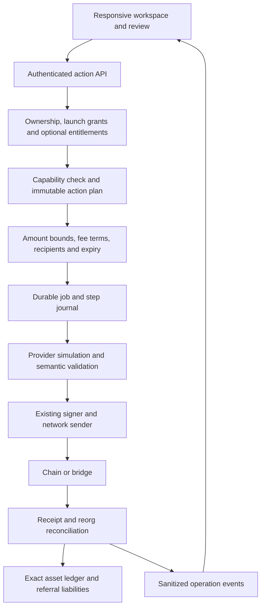

# Proxima research and Helm infrastructure plan

Reviewed 15 November 2026. This is an original product and engineering analysis of public documentation, checked against Helm's current source. It is not a claim of access to Proxima's backend, contracts, infrastructure or private API. The cited guides describe product behavior; the architecture below is a proposal for Helm. No reusable public Proxima SDK or integration API was established by this review.

Helm product update: trading automation has been permanently removed at the owner’s request. Proxima strategy features are excluded from Helm’s implementation scope. Historical transactions remain available.

## Helm economics

The current requested policy replaces the earlier $20 launch fee and 1%/2% trading proposals:

| Action | Helm fee | Basis |
| --- | --- | --- |
| Token launch | Free for every account | No launch payment, subscription or price feed prerequisite |
| Buy, sell, swap or initial developer buy on Helm | 2.5% | Buy input or verified sell proceeds; disclose asset, raw amount and destination |
| Creator rewards from new Helm launches | 2.5% | Creator rewards, not token supply, LP principal or trading notional |
| Referral | 30% of the Helm fee actually received | Liability deducted from Helm revenue, never an additional user charge |
| Optional future Pro infrastructure | Undecided | May cover advanced resources; must not gate basic free launches |

Example: a $100 trade generates a $2.50 Helm fee. A qualifying direct referrer earns $0.75; Helm retains $1.75. A separate $100 of creator rewards allocates $97.50 to the creator and $2.50 to Helm before its referral obligation. Gas and launchpad costs remain separate. Imported tokens do not acquire a new native reward split. Historical immutable splits retain their original terms.

Proxima documents input-based buy fees, proceeds-based sell fees, and reward-claim fees. Its other rates and referral levels are not Helm policy. [Fee guide](https://docs.proxima.tools/other/platform-fees/), [referrals](https://docs.proxima.tools/account/referral/).

## What is useful, and what Helm needs

| Area and documented behavior | Helm today | Proposed infrastructure and acceptance condition | Order |
| --- | --- | --- | --- |
| Launch-scoped collaboration: named invites or approval links, individual actions, selected wallets, revocation and optional expiry. [Guide](https://docs.proxima.tools/live-settings/collaborate/) | Ownership checks and global admin roles; no launch membership model. | `LaunchMember`, hashed `LaunchInvite`, explicit action grants and immutable wallet IDs. Default read-only; future wallets opt-in. Revalidate grants before every signature and manually confirmed action. Revocation tests must cover already queued work. Never delegate key export by default. | P1 |
| Floating instant-trade panel, wallet selection, presets and armed hotkeys. [Guide](https://docs.proxima.tools/live-settings/instant-trade/) | Workspace trade forms with review and idempotency. | Shared trade composer with responsive bottom sheet on phones. Persist presentation locally; clear wallet scope on launch changes. A future instant mode needs bounded, expiring consent and server enforcement. Ignore hotkeys inside inputs and disable them when hidden. | P2 |
| Reward claims, launch-specific distribution choices and staking rewards. [Guide](https://docs.proxima.tools/live-settings/claim-creator-fees/) | Several separate claim adapters; native split support varies. Pons has pinned historical contracts. | Common reward adapter returning asset, raw claimable amount, recipient, collection mode, scope and irreversible choices. Receipt-verified reward ledger; native split OR claim deduction, never both. Treat principal, cashback and creator rewards separately. | P0 |
| Archived-launch asset recovery, chain funding checks and progress by launch. [Guide](https://docs.proxima.tools/account/recover-dust/) | Consolidation, sweep, gas sponsorship and funding primitives. | Read-only inventory followed by a signed recovery manifest. Separate native, token, quote, reward and LP assets. Selling positions must be explicitly selected. Limit total gas sponsorship; retain small uneconomic assets visibly. Partial recovery must not imply an empty wallet. | P1 |
| Reusable funding wallets, chain defaults, bridge deposits and withdrawal history. [Guide](https://docs.proxima.tools/funder/funder/) | Funders, managed wallets, Relay/deBridge routing and same-origin API. | Persist per-network defaults, exact transfer plans and route status. Pin destination, input cap, minimum receipt, expiry and provider. Reconcile each bridge leg; never resend a timed-out bridge because the destination balance is delayed. | P1 |
| Wallet allocation review, quote-asset funding and launch readiness. [Guide](https://docs.proxima.tools/create-launch/funding/) | Deployment previews and auto-funding; per-chain adapter configuration. | One launch-readiness resource: artwork completion, eligibility, balances, gas, quote, reward collection and adapter version. Freeze reviewed allocations into the job. Recheck immediately before signing. | P0 |
| Manual and timed launch execution, restricted to supported routes. Separate transactions do not guarantee block ordering. [Guide](https://docs.proxima.tools/create-launch/launch-settings/launch-modes/) | Launch job plus developer buy and separate holder trades. | Persistent dependency graph for create → confirm → reward setup → optional holder orders. Display independently confirmed legs. Any future private bundle path needs a verified relay adapter, bundle simulation and expiry. | P2 |
| Streamflow supply locks with duration and unlock date. [Guide](https://docs.proxima.tools/live-settings/lock-supply-via-streamflow/) | Supply lock capability is false; do not expose a working lock control. | Official SDK/program verification, mint/owner/authority checks, exact token amount, beneficiary and unlock timestamp. Record the resulting stream address; claim, cancel and transfer capabilities must come from the actual stream settings. | P2 |
| Uniswap LP inventory, removal and irreversible LP burns. [Guide](https://docs.proxima.tools/live-settings/liquidity-pool/) | V2 creation and LP handling at deployment; no unified live position service. | Separate V2 LP-token positions from V3/V4 position NFTs. Quote minimum outputs and deadline for removal. Distinct burn/remove actions and explicit risk acknowledgement. Never treat recovered liquidity principal as creator rewards. | P2 |
| Profile and period/chain performance views, daily P&L and share cards. [Guide](https://docs.proxima.tools/account/dashboard/) | Dashboard, profiles, charts, tracker and P&L cards exist. | Trade-lot attribution, external transfers, gas, both Helm fees and realized/unrealized separation. Missing quotes remain unpriced. Add calendar aggregation after accounting invariants; cache by chain/block and disclose freshness. | P1 |
| Referral charts, actual-collection settlement and chain-specific claims. [Guide](https://docs.proxima.tools/account/referral/) | Direct referral attribution, exact fee splits, multi-asset liabilities and payout destinations. | Receipt-backed settlement batches and payout job IDs with reconciliation. Earnings states: estimated, collected/owed, submitted, paid or reverted. Never pay against configured-but-unreceived creator shares. Keep the requested single 30% level. | P0 |
| Support tickets with operation context and safe diagnostic attachments. [Guide](https://docs.proxima.tools/other/report-a-problem/) | Admin audit, transactions, jobs and error states. | Export a sanitized operation report: job, network, pad, public signatures, provider and timestamps. Redact secrets and user data before export; send only on explicit user action. Link service incidents to affected jobs. | P1 |
| Rich launchpad-specific configuration and quote compatibility. [Options](https://docs.proxima.tools/create-launch/launchpad-options/), [coverage](https://docs.proxima.tools/overview/supported-launchpads-and-blockchains/) | Sixteen implemented adapter identifiers plus planned integrations, including Elpida. Implementation is not mainnet certification. | Versioned per-pad/network/variant capability registry. Require official ABI/program, deployed code, simulation, reward collection and receipt tests for each route. Show create, trade, claim and liquidity readiness independently. | P0 |

P0 means release correctness; P1 means the next infrastructure milestone; P2 means an advanced feature after the foundations are proven. These are dependencies, not delivery-date promises.

## Creator-reward collection is the main release constraint

The fee policy is global, but collection must match each launchpad's actual mechanism. A native split reserves 2.5% once; subsequent claims must not deduct another 2.5%. A claim-time collector needs proof of the reward assets actually received, excluding existing balances and unrelated wallet-wide claims.

| Helm route | Implementation path | Remaining release requirement |
| --- | --- | --- |
| Pump.fun | Native sharing configuration, 9,750 / 250 basis points; required setup transaction after creation. | Verify current program/builder behavior and reconcile native treasury payouts. Token creation with uncertain split setup remains visibly incomplete. |
| Bags SOL | Native fee-share configuration, 9,750 / 250; no partner commission layered on top. | Verify live API behavior and exact receipt accounting. |
| Bags paired assets | Existing route does not expose the same fee-share step. | New collection integration; block new deployment for this variant until verified. |
| Clanker Base / Robinhood | Native locker recipient allocation, 9,750 / 250 of creator-side rewards. | Verify network deployments and receipt attribution for both token and quote reward assets. |
| Pons | Separate `HelmPonsRewardsV2` and factory at 250 bps. Existing 600-bps bytecode remains pinned for historical claims. | Deploy and verify the new factory, configure its separate address, and pass chain acceptance. Never reuse the old factory as though it charged 2.5%. |
| Meteora DBC, Printr, LetsBonk | Existing claim/external reward paths do not establish universal 2.5% collection. | Implement and verify per-token reward receipt scope or a native recipient. New reward-bearing deployment remains gated. Existing token management continues. |
| Flap taxed variants | Automatic creator-tax distribution differs from a reward claim. | Verified recipient/split integration. Commission is a distinct mechanism and cannot be presented as the same 2.5% without proof. Zero-tax standard modes have no creator stream to split. |
| Standard Four.meme, Uniswap V2, SunPump, Meme.Cooking, Tolly | Current implemented modes expose no separate creator-reward stream handled by Helm. | Keep explicit not-applicable capability for these modes; verify any newly added creator-income variant before enabling it. LP principal and auction refunds are not rewards. |

Gate scope is new deployment, not access to an existing token's balances or its historical claims. The public capabilities and deploy preview must reveal missing collection paths. Do not advertise a fee as collected merely because a launch's policy says 250 bps.

## Proposed shared architecture

This design extends Helm's existing services rather than introducing one independent transaction sender per feature.

Suggested new resources:

- `RewardPosition`: launch, adapter version, asset contract, decimals, immutable recipients, split version, observed block and claim scope.
- `RewardReceipt`: chain, transaction, event index, position, exact gross reward, Helm share, referral liability and finality state. Unique chain/event identity prevents duplicate income.
- `Strategy` / `StrategyRun`: versioned trigger, exact wallet scope, budget, deadline, minimum output, dispatch lease and unique trigger occurrence.
- `RecoveryPlan`: inventory snapshot, selected assets, destination per network, maximum funding and signed user choices. Each step links to the existing job journal.
- `LaunchMember` / `LaunchInvite`: explicit permissions, hashed invitation token, inviter, wallet IDs, expiry and revocation audit.
- `PayoutBatch`: immutable beneficiary/asset rows, allocated liabilities, signed transaction identities and receipt-based settlement.
- `ProviderHealth`: per-chain availability, latency, stale-block detection and circuit-breaker state. Store no credentials in client diagnostics.
- `Entitlement`: optional future Pro resources such as longer analytics retention, advanced analytics or team seats. Basic launch permission must remain independent of subscription state.

Any new tables need migrations and real PostgreSQL concurrency tests. External on-chain events need a durable indexer cursor, idempotent event ingestion and a reorg/finality policy. A websocket is a delivery mechanism, not the source of truth: clients reconnect using a cursor and retrieve canonical jobs over HTTP.

## Launchpad expansion shortlist

The following are research candidates named in Proxima's coverage, not newly supported Helm integrations. [Coverage](https://docs.proxima.tools/overview/supported-launchpads-and-blockchains/), [configuration guide](https://docs.proxima.tools/create-launch/launchpad-options/).

| Group | Candidates to investigate | Why / prerequisite |
| --- | --- | --- |
| Extend existing Solana foundation | Raydium LaunchLab, direct Meteora DBC, Surge, Anoncoin, StonkFun | Reuse Solana execution, but inspect each program/config and reward scope. LaunchLab platform settings are a separate dependency. |
| Extend existing EVM foundation | Bankr, Uniswap V3/V4, additional Flap variants | Reuse chain RPC/signing; add position accounting, verified factories and protocol-specific fee semantics. |
| Robinhood-specific | Hood, klik, long, meme.bid, o1, Flywheel, CoinBarrel, Realm, Livo | Verify live chain identifiers, factory code, ownership powers, migration behavior and permanent tax/reward choices. |
| BSC | genius, knot, Stoxes | Separate protocol taxes, founder income and Helm fees. Inspect launch eligibility and post-graduation liquidity. |
| Arc / X Layer | Argus, Foci, LIFT, Znipe; ignix on X Layer | Do not infer that another EVM adapter works: verify native gas asset, contracts, indexing and quote support. |
| Multichain | Pangea | Treat source and destination launches as a distributed workflow with independent receipts and recovery; no claim of atomic cross-chain completion. |
| Helm's own roadmap | Elpida | Remains planned until official deployments, program/ABI, creator rewards, quotes and mainnet acceptance are verified. Proxima documentation is not evidence for Elpida readiness. |

## Security, reliability and device requirements

1. Every action uses the existing managed-wallet ownership checks, idempotency keys, reviewed plan and execution journal. Collaboration adds grants; it must never bypass ownership or signer policy.
2. Every financial amount is integer base units or Decimal. Fees are floored once at the documented boundary; preserve the remainder and exact gross = Helm net + referral liability invariant.
3. Provider-built transactions require semantic checks on program/contract, asset, recipient, spend ceiling and minimum receipt. A successful simulation alone is insufficient.
4. After signing, persist transaction identity before broadcast. Timeouts enter reconciliation, not automatic repeat execution. Cancellation cannot undo a broadcast.
5. Referral payouts reserve liabilities atomically and only become paid on verified transfers. Creator configurations and quotes are not revenue.
6. Indexers use finality thresholds and repair removed/reorged events. Manual trade previews refuse stale or missing quotes.
7. Test PostgreSQL leases, concurrent claims, duplicate events, partial bridges, app restarts and provider outages. Offline adapter tests do not certify mainnet contracts.
8. Preserve mobile review screens: one-column operation summaries, 44-pixel touch targets, no horizontal amount truncation, accessible dialogs, keyboard focus restoration and reduced-motion support. Floating trade panels become bottom sheets on narrow screens.
9. Public launchpad cards should show what works per action and why an action is unavailable. A planned pad should never look ready because a logo exists.
10. Secrets stay in the server signer/provider configuration. Diagnostic exports, support tickets and browser analytics must exclude keys, bearer tokens, TOTP secrets and private wallet data.

Some Proxima guides also describe wallet-layer visibility tuning and activity-generation products. This plan extracts their general execution dependencies and cost-preview lessons. It does not propose deceptive trading volume, detection-evasion promises or guarantees about transaction ordering. [Launch modes](https://docs.proxima.tools/create-launch/launch-settings/launch-modes/), [Block-0 settings](https://docs.proxima.tools/create-launch/launch-settings/block-0-configuration/).

## Delivery sequence

1. Finish the free-launch / 2.5% / 2.5% policy, native split consent, V2 Pons artifacts, missing-integration gates and fee tests. Validate deployment migration and real receipts before claiming live coverage.
2. Add receipt-backed reward ingestion and referral payout settlement. These establish correct economics for every later feature.
3. Add read-only recovery inventory and a reviewed recovery plan; improve funder balances and launch readiness.
5. Add scoped collaboration and durable operation notifications; retain strict server-side permissions.
6. Add LP management, Streamflow locks and verified staking positions. Expand launchpads individually against the same acceptance contract.
7. Introduce optional Pro resource entitlements only after the relevant capabilities exist. No subscription price or launch paywall is implemented by this research.
